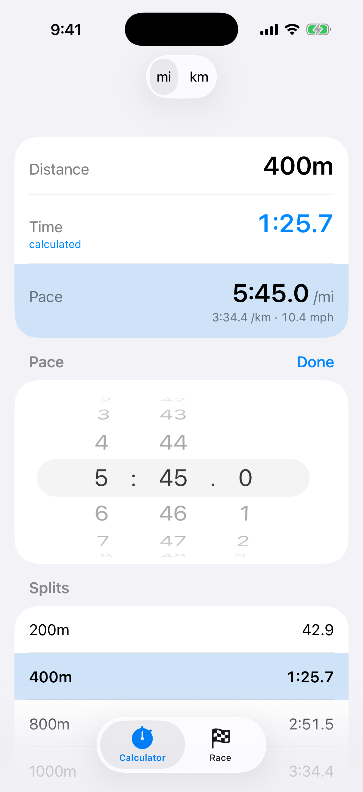
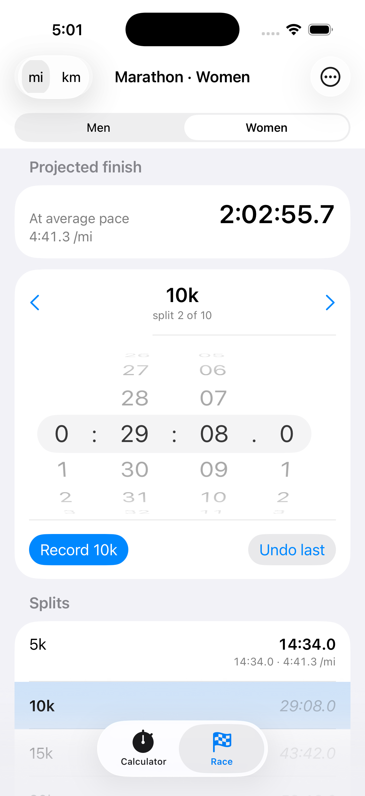
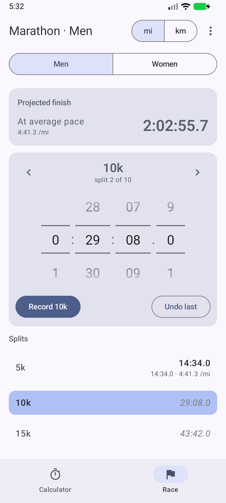

# Split Pace Pro

A fast, no-fuss pace calculator for runners and race fans, for iPhone, iPad, Mac and Android. Scroll to set your distance and time (no typing) and get your answer instantly. Then follow live races split by split with projected finish times.

  
  
  

## Features

### Pace calculator

- Enter a distance and time to get your pace, or set a pace to get your time
- See per-mile and per-km pace side by side, plus speed in mph or km/h for the treadmill
- A splits table shows your time at that pace for every common distance: 200m, 400m, 800m, 1000m, 1500m, mile, 3000m, 5k, 10k, 15k, 10 miles, half marathon, marathon and 50k
- Tap any distance to jump to it at the same pace
- Enter any custom distance in miles or kilometers
- Every time is shown to a tenth of a second

It answers questions like:

- What should I run each 400m in to hold 5:45 per mile? **1:25.7**
- What pace was my 800m in 2:45? **5:31.9 per mile**
- The leaders went through 5k in 14:34. What will they finish the marathon in at that pace? **2:02:55.7**

### Race mode

Follow a race live, split by split:

- **Track races:** 800m, 1500m, mile, 3000m, 5000m and 10,000m, with the real split points (300m first lap in the 1500, 409m in the mile, 200m in the 5000)
- **Road races:** 5k, 10k, half marathon and marathon, with 1k, 5k or mile splits
- Enter each split as it happens. The time is pre-filled with the even-pace estimate, so you usually just adjust a few seconds
- See the projected finish at both the average pace and the pace since the last split
- Lap pace per 400m for track races; pace per mile or km for road races
- Follow the men's and women's races at the same time and switch with one tap
- Missed a split? Skip it. Made a mistake? Edit or undo it
- Races are saved automatically, even if you close the app

## Support

Found a bug, have a question, or want to suggest a feature? [Open an issue](../../issues) on this repository, and include your device and what you were doing if something went wrong.

### Common questions

**How do I enter a time?** Tap Distance, Time or Pace and scroll the numbers to set it. Tap the same row or **Done** to close it.

**Which value gets calculated?** Distance is always what you set. Of time and pace, whichever you changed last stays fixed and the other is calculated, shown in blue and labelled "calculated".

**How do I change between miles and kilometers?** Use the **mi / km** switch at the top for pace. When entering a custom distance, scroll its unit (mi or km) separately, so you can enter e.g. 15 km while seeing pace per mile.

**How do I follow two races at once?** In the Race tab, open the menu (**…** on iPhone, **⋮** on Android) → **Add race** for each one (for example the men's and women's marathon), then switch between them at the top.

**How do I fix a wrong split?** Select it in the split list, adjust the time and tap **Update**, or tap **Clear**. On iPhone you can also swipe a split to clear it; on Android, long-press it.

## Privacy

Split Pace Pro doesn't collect, store or share any personal data. There are no accounts, ads, analytics or tracking, and the app makes no network connections. Your settings and saved races stay on your device and are removed when you delete the app.

## Building from source

- **iOS / iPadOS / macOS:** SwiftUI app. The Xcode project is generated with [XcodeGen](https://github.com/yonaskolb/XcodeGen): run `xcodegen generate`, then open `PaceCalculator.xcodeproj`. The calculation logic lives in the `PaceCore` Swift package (`swift test` in `PaceCore/`).
- **Android:** Kotlin + Jetpack Compose in `android/`. Build with `./gradlew assembleRelease` (requires JDK 17+, e.g. Android Studio's bundled one).

Both platforms are checked against the same test cases in `PaceCore/Tests/PaceCoreTests/fixtures.json`. See [docs/PLAN.md](docs/PLAN.md) for the design.

## License

Split Pace Pro is free, and should stay that way. You're welcome to use it, read and learn from the code, change it for yourself, and share it — as long as it's not for commercial purposes. That means you can't sell it, sell a copy or clone of it, or put ads in it.

The full terms are the [PolyForm Noncommercial License 1.0.0](LICENSE.md).

Required Notice: Copyright 2026 Conor Sleith (https://github.com/conorsleith/split-pace-pro)
